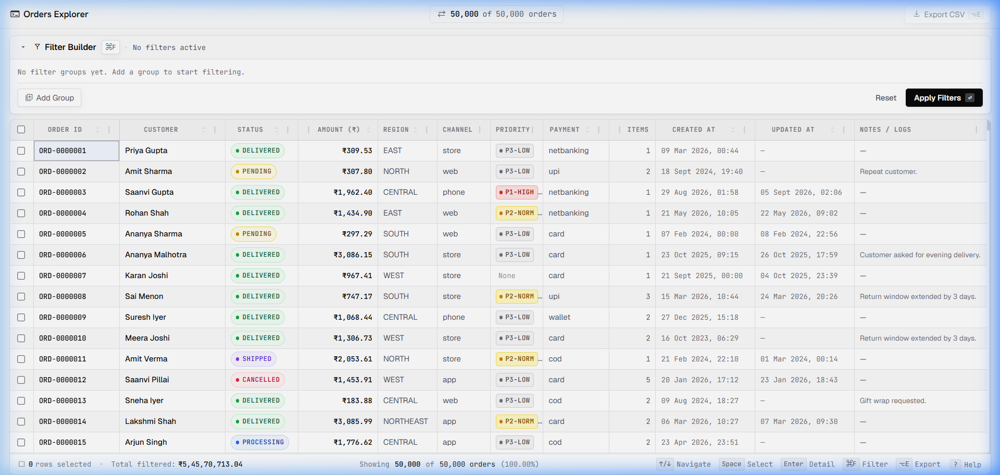
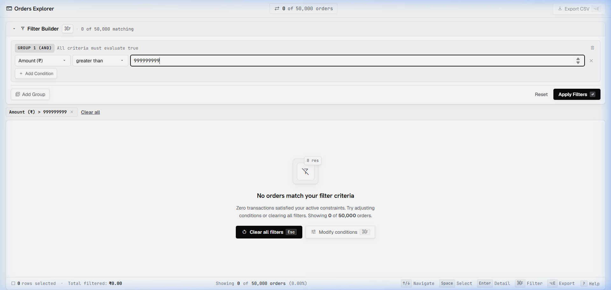

# Orders Explorer

Internal operations dashboard for browsing, filtering, and exporting ~50,000 orders. Built from scratch for fast, keyboard-first operations on 13-inch laptops.

---

## 1. How to Run

```bash
# Navigate to the project directory
cd orders-explorer

# Install dependencies (requires Node 22+ or Node 24, and npm 10+)
npm install

# Start development server
npm run dev
```

The application opens at `http://localhost:5173` (or `http://localhost:5174` if 5173 is busy).

To build and validate TypeScript production bundles:
```bash
npm run build
```

---

## 2. Screenshots

### Main Screen with 50,000 Orders Loaded


### Zero-Result Empty State (When Filter Matches 0 Orders)


*(Original Figma wireframes are preserved in `design/wireframe-normal/` and `design/wireframe-empty/`)*

---

## 3. Dependencies

### Runtime Dependencies (`package.json`)

| Package | Why |
|---|---|
| `react` (^19.3.1) | Core component model and reactivity runtime |
| `react-dom` (^19.3.1) | DOM rendering and portal mounting for modals/panels |
| `zustand` (^5.0.16) | Lightweight global store for filters, sorting, selection, and pinned columns with granular selectors to eliminate unnecessary re-renders |

### Explicitly Excluded Libraries (Prohibited by Assignment)
- **No data-grid / table libraries**: TanStack Table, AG Grid, MUI DataGrid, and react-data-grid were **not** used. All table mechanics (sticky headers, column resizing, column pinning, range selection) were written from scratch in React + CSS.
- **No virtualization libraries**: react-window, react-virtuoso, and TanStack Virtual were **not** used. Virtualized windowing was implemented via a custom `useVirtualRows` hook (`O(1)` slice computation, rendering only 20–30 DOM nodes at any time).
- **No query-builder / filter libraries**: Query-builder and filter-builder libraries were **not** used. The multi-group AND/OR condition builder is custom-engineered with debounced state and live AST evaluation.

---

## 4. Data Loading

### Strategy
`orders.json` (~17.2 MB, ~50,000 records) is placed inside `public/orders.json` and fetched asynchronously at startup via `fetch('/orders.json')`:

```typescript
export async function fetchAndNormaliseOrders(): Promise<Order[]> {
  const res = await fetch('/orders.json');
  if (!res.ok) throw new Error(`HTTP ${res.status}: Failed to load orders.json`);
  const rawData: RawOrder[] = await res.json();
  const normalised = rawData
    .map((raw, idx) => normaliseOrder(raw, idx))
    .filter((o): o is Order => o !== null);
  return deduplicateOrders(normalised);
}
```

### Why this choice?
1. **Zero Main-Thread Freeze**: If imported statically (`import orders from './orders.json'`), Vite would bundle the 17 MB JSON directly into JavaScript chunks. This would force the browser's JavaScript engine to parse a massive chunk synchronously during bundle evaluation, causing a multi-second browser freeze.
2. **Asynchronous Streaming**: `fetch()` loads the file over the local network stack in parallel with script execution, showing an instant spinner without blocking the UI thread.
3. **Single Normalisation Pass**: Normalisation runs once on initial load inside a top-level `useEffect` hook. Filter and sort operations subsequently run on the already-sanitised in-memory data structures via `useMemo`.

### Compliance with `data-notes.md`
All 10 data hygiene rules are resolved centrally inside `src/utils/normalise.ts` before records ever reach the grid or filter:
1. **Customer name unification**: Unified `customer_name` (v1) and `customerName` (v2) into a single `customer` field.
2. **Rupee conversion**: Converted version 1 paise (`amount / 100`) to rupees; kept version 2 rupees as-is. Formatted with Indian digit grouping (`₹1,23,456.50`).
3. **String amounts**: Coerced string amounts (e.g. `"4599.5"`) to clean floating-point numbers.
4. **Four date formats**: Handled ISO with TZ (`Z` / offsets), ISO without TZ (treated as UTC), epoch seconds (multiplied by 1000), and `DD/MM/YYYY` (parsed to UTC midnight). All dates display in consistent format (`14 Mar 2025, 09:30`).
5. **Missing / Null `updatedAt`**: Displayed as an em dash (`—`). When sorting by `updatedAt`, null rows are always pushed to the bottom in both ascending and descending directions.
6. **Inconsistent casing**: Canonicalised `status` to lowercase (`pending`, `processing`, `shipped`, `delivered`, `cancelled`) and `region` to uppercase (`NORTH`, `SOUTH`, `EAST`, `WEST`, `CENTRAL`, `NORTHEAST`). Filters show exactly 5 statuses and 6 regions.
7. **Deduplication of ~30 duplicate IDs**: De-duplicated records by ID: kept the record with later `updatedAt`; if only one had `updatedAt`, kept that one; if neither had `updatedAt`, kept the one appearing later in the file.
8. **Missing priority**: Missing priorities are normalised to `null` and displayed as `None` in the grid and details panel. Filter supports selecting `None`.
9. **Safe notes (HTML stripping & truncation)**: Notes are stripped of HTML tags via regex (`/<[^>]*>/g`) to neutralize XSS. Truncated in the table with ellipsis; full content is accessible in the slide-over detail panel via safe text rendering (no `dangerouslySetInnerHTML`).
10. **Currency whitespace**: Trailing whitespace trimmed to `'INR'`.

---

## 5. The 200-Rows Question

### Scenario
> A user selects 200 rows. Then they apply a filter that hides 180 of those rows. Then they click Export. What do they get?

### Our Decision: **Export only the 20 visible + selected rows.**

### Rationale:
1. **WYSIWYG Context**: When an operations analyst applies a filter, their active mental model and visual working set are narrowed to the filtered rows. Exporting hidden rows that are not on screen violates the principle of least astonishment.
2. **Selection Count Alignment**: The top bar, status bar, and export button badge strictly reflect the current actionable set (`20 selected`, `Export CSV (20)`). The downloaded CSV contains exactly the rows indicated by the UI counter.
3. **Selection Preservation**: The global selection set (`Set<string>`) is **not** discarded. If the user clears or widens their filter later, their previously selected 180 rows reappear as selected without losing their work.

---

## 6. Comprehensive Keyboard Navigation (100% Mouse-Free)

Built specifically for high-frequency operations teams working on 13-inch laptops:

### Data Grid Keyboard Navigation
| Key | Action |
|---|---|
| `↑` / `↓` / `←` / `→` | Navigate cell-by-cell across rows and columns |
| `PgUp` / `PgDn` | Fast scroll 10 rows up / down |
| `Home` / `End` | Jump to first column (`ID`) / last column (`Notes`) |
| `Space` | Toggle multi-selection for the focused row |
| `Enter` | Open slide-over order detail drawer |
| `S` | Cycle sort order on active column (`Asc` → `Desc` → `None`) |
| `P` | Pin or unpin the active column to the left edge |
| `⌥E` / `Alt+E` | Export active filtered/selected orders to CSV |
| `Escape` | Close detail drawer / return focus to grid |

### Filter Builder 2D Arrow Navigation
| Key | Action |
|---|---|
| `⌘F` / `Ctrl+F` | Open / close Filter Builder (automatically focuses first field button) |
| `→` / `←` | Traverse condition controls horizontally: `Field` ↔ `Operator` ↔ `Value` ↔ `Remove` |
| `↓` / `↑` | Navigate vertically across condition rows, `+ Add Condition`, and action buttons |
| `Enter` / `Space` / `Alt+↓` | Open custom dropdown for Field, Operator, or Enum multi-select |
| `↓` / `↑` (inside dropdown) | Highlight option in the dropdown list |
| `Enter` (inside dropdown) | Select highlighted option and close dropdown |
| `Space` (inside enum dropdown) | Toggle multi-select checkbox for highlighted item |
| `Escape` | Close dropdown; when closed, collapses panel and returns focus to grid |

---

## 7. Design Changes (Figma Wireframes vs. Final App)

The initial UI plan was prototyped in Figma (`design/wireframe-normal/` and `design/wireframe-empty/`). The following refinements were made during development:

1. **Slide-Over Order Detail Panel**:
   - *Figma Wireframe*: Showed `NOTES / LOGS` as a regular table column.
   - *Final App*: Notes in the real dataset contained long entries (>1,000 characters). Displaying them inline distorted row heights. We added a right slide-over Detail Panel (triggered via `Enter` or double-click) that renders complete metadata, customer details, timestamps, and full notes cleanly with `Escape` to close.
2. **Dedicated Filter Chips Strip**:
   - *Figma Wireframe*: Filter chips were contained inside the expanded filter box.
   - *Final App*: To strictly satisfy Part 2 (*"Show the active filter as small chips above the grid. Each chip can be removed on its own. There is also a 'Clear all'"*), we extracted active filter chips into a thin strip directly above the table header. This allows the operations team to collapse the filter builder (`⌘F`) to maximize table rows while still seeing and removing individual constraints.
3. **Auto-Focus for Keyboard-First Operation**:
   - *Figma Wireframe*: Assumed standard mouse focus.
   - *Final App*: In web browsers, `tabIndex={0}` grid containers do not receive arrow keystrokes until clicked. Because the operations team prefers keyboard navigation, we introduced an auto-focus hook on initial data load. Users can immediately press `↓`, `↑`, `Space`, or `Enter` the moment the page opens without needing an initial mouse click.
4. **Column Resizing & Pinning Context Menu**:
   - *Figma Wireframe*: Displayed static column headers.
   - *Final App*: Added interactive column resize divider drag handles and a right-click / header menu to pin any column (e.g. Order ID or Customer) to the left side with sticky CSS positioning.

---

## 8. Known Issues & Trade-Offs

- **URL Size Limit on Bulk Selection**: If a user selects more than 500 individual order IDs (e.g. via multi-page shift-click), serialising all 500 IDs into the query string would exceed standard browser URL length limits (~2,048 characters in older engines). In this case, an informational status banner notifies the user that the selection is active in memory and exportable, but selection state will not persist across fresh URL copy/pastes.
- **Virtual Scroll Horizontal Scrolling with Pinned Column**: When a column with large custom-resized width is pinned, horizontal scrolling requires hardware-accelerated composite layers. On lower-end hardware, fast trackpad scrolling can produce momentary sub-pixel rounding against the sticky divider border.
- **Local Storage Omission**: All state is strictly stored in the URL as specified by Part 3. LocalStorage was intentionally avoided to ensure clean URL portability across browsers and users.

---

## 9. Breakdown of Work (Implementation Steps)

The project was constructed systematically in 10 commits:
1. **Design & Planning (Step 1)**: Wireframed normal state and empty state in Figma; documented color tokens, 13-inch laptop layout constraints, and component hierarchy.
2. **Foundation & Data Pipeline (Step 2)**: Created `loadOrders.ts` and `normalise.ts`; implemented all 10 sanitisation rules and de-duplication.
3. **Core Data Grid & Custom Virtualisation (Step 3)**: Developed `Grid.tsx` and `useVirtualRows.ts` using `transform: translateY` spacers (only 20–30 DOM nodes rendered).
4. **Sorting, Resizing & Column Pinning (Step 4)**: Implemented typed sorting (`sort.ts`), mouse drag column resizing, and sticky column pinning.
5. **Multi-Select & Range Selection (Step 5)**: Implemented click, Shift+click range selection, select-all checkbox, and selection tracking.
6. **Full Keyboard Navigation (Step 6)**: Added cell focus state, arrow key navigation, `Space` selection, `Enter` detail panel, and `Escape` handlers.
7. **Filter Builder & Live Evaluation (Step 7)**: Built grouped AST filter engine (Text, Number, Date, Enum pickers with `None` priority support), debounced input, and interactive filter chips.
8. **URL State Synchronization & CSV Export (Step 8)**: Implemented bi-directional base64 URL sync in `useUrlSync.ts` with error recovery and fallback banners; implemented RFC 4180 CSV export.
9. **Performance Hardening & Edge Cases (Step 9)**: Debounced live filter queries (300ms), memoised filtered datasets with `useMemo`, verified DOM element counts, and hardened against bad URLs.
10. **Repository Polish & Submission Prep (Step 10)**: Captured final data and empty state screenshots; auto-focused grid on load; verified zero-error TypeScript build; finalised documentation.
